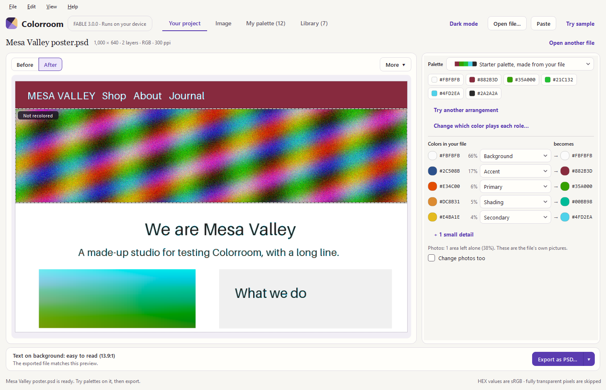
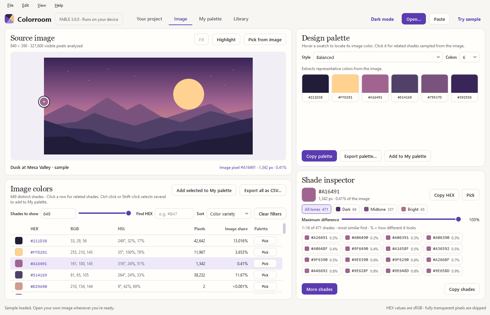
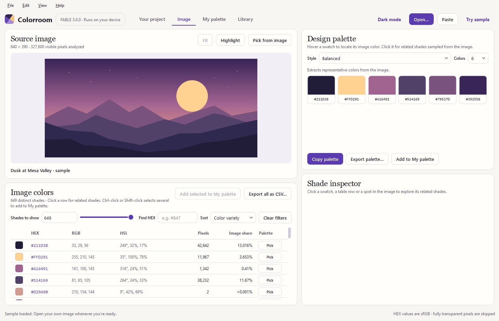

# Colorroom FABLE

**Recolor your own design and get the same file back.** Open a Photoshop, Illustrator,
InDesign, PDF or image file, try palettes on it, and export it in the same format with the new
colors on its real layers, ready to edit. When Photoshop, Illustrator or InDesign is installed,
Colorroom asks that program to make the change, so text stays text and vectors stay vectors,
then checks every color in the saved file.

Colorroom FABLE also finds the colors in any image: every distinct HEX shade, where each one
appears, its related shades, and design palettes built from them.

It is a standalone desktop app written in Python, rebuilt from the Colorroom web page.
Everything runs on your computer: files are never uploaded, and the app never connects to the
internet.





**Status:** version 3.0, for Windows. macOS support is planned. What works, the known limits
and what comes next are in [ROADMAP.md](ROADMAP.md). The original browser version,
Colorroom 1.7, is still here: download [`legacy/index.html`](legacy/index.html) and open it in
a browser.

## Install

You need Windows and [Python](https://www.python.org/downloads/) 3.11 or newer.

```powershell
git clone https://github.com/Matthew-Hoke/colorroom.git
cd colorroom
python -m venv .venv
.venv\Scripts\python -m pip install -e ".[dev,adobe]"
```

`adobe` installs pywin32, which lets Colorroom drive Photoshop, Illustrator and InDesign on
Windows. Leave it out and everything else still works; Colorroom then writes the files itself.

## Start the app

| How | What to do |
|---|---|
| Easiest | Double-click **`Run Colorroom FABLE.bat`** in the project folder. |
| From a terminal | `.venv\Scripts\python -m colorroom` (add an image path to open it directly). |
| From VS Code | Open the folder, then **Terminal > Run Task… > Run Colorroom FABLE**, or press **F5**. |
| Standalone app | Build it once (see below), then double-click `dist\Colorroom FABLE\Colorroom FABLE.exe`. |

## What you can do

The window has four tabs. **Your project** recolors your own design file and gives it back.
**Image** finds the colors in a picture. **My palette** is where you collect colors and get them
ready for real work. **Library** keeps the palettes you want to come back to, in folders.

### Your project tab

- **Open your file**: Open file…, drag and drop, or paste. Photoshop (`.psd`, `.psb`),
  Illustrator (`.ai`), InDesign (`.indd`, `.idml`, through InDesign), PDF, PNG, JPG, WebP, GIF,
  BMP, AVIF and TIFF. The header shows its size, layers, color mode and resolution.
- **Try palettes on it**: pick one of your palettes, a Library palette, or an idea made from
  the file's own colors. With no palette of your own, a starter palette is made from the file,
  so the first result needs no settings.
- **Colors in your file**: each main color of the file, how much of it there is, which role
  replaces it (or Keep), and the color it becomes. "Try another arrangement" asks for a
  different automatic choice; "Change which color plays each role…" sets roles by hand.
- **Before / After** (or the `\` key) compares with the original without losing your choices.
- **Photos are left alone**: photographs and placed pictures stay as they are and only flat
  color, shapes and text change. In design files Colorroom knows which layers hold pictures; in
  a flat image or a screenshot it makes a best guess. Drag a box on the picture to leave any
  area alone, or tick "Change photos too".
- **Readable text**: a line under the picture says how readable the text color is on the
  background.
- **Export** (Ctrl+E), one button that follows your file:

  | Your file | The button | What happens |
  |---|---|---|
  | `.psd`, `.psb` with Photoshop installed | **Export to Photoshop** | Photoshop changes the colors on the real layers of a copy (text, shapes, fill layers, gradient maps, gradients, layer effects); Colorroom checks every color in the saved file |
  | `.ai` with Illustrator installed | **Export to Illustrator** | Illustrator sets the exact HEX on fills, strokes, text, gradients and swatches of a copy; still vectors |
  | `.indd`, `.idml` with InDesign installed | **Export to InDesign** | InDesign changes the swatches of a copy, so every frame, text run, tint and gradient follows |
  | `.psd` without Photoshop | **Export as PSD…** | Colorroom writes the PSD: pixel layers recolored in place; colors held by text or shapes go on one extra layer on top |
  | `.ai` without Illustrator | **Export as PDF…** | A PDF that Illustrator opens, with the artwork as one picture |
  | anything else | **Export as PNG…**, **JPEG…** and so on | The same format at full size and resolution |

  The arrow beside the button offers the other formats and the palette as swatches. Your
  original is never changed: the copy is saved beside it as `name - Colorroom A`. The first
  time Colorroom would start one of your programs it asks you first. Afterwards a report says
  what changed, what was left alone and why, and that every color was checked.

### Image tab

- **Open an image**: the Open button, drag and drop, paste from the clipboard (Ctrl+V), or "Try sample".
  PNG, JPG, WebP, GIF, BMP, AVIF and TIFF, up to 24 megapixels.
- **Open a document**: PDF files, Illustrator `.ai` files saved with "Create PDF Compatible
  File" (Illustrator's default), and Photoshop `.psd` and `.psb` files. Every page or artboard
  becomes a page. Animated GIFs and multi-page TIFFs get pages too.
- **Pages**: a strip of thumbnails down the left, each with a bar of that page's main colors, so
  you can see where the palette changes. Click a page, use the arrows or Page Up / Page Down, or
  type a page number. Page 1 shows first and the rest fill in behind it.
- **Exact colors**: for PDF and Illustrator files Colorroom also reads the fill and stroke colors
  written in the file, which are more truthful than sampled pixels. CMYK and spot colors are
  shown converted to screen colors, so treat those as close matches.
- **Whole document**: one palette across all pages: which colors are on every page, which appear
  on one page only, and which are nearly the same (often one brand color typed two ways). Send
  the result to My palette.
- **Look closer**: scroll to zoom, drag to move around, double-click to fit. **Highlight** (H) dims
  the picture except for the pixels of the color you are inspecting, so you see where it lives.
- **Design palette**: 13 styles. Balanced and Dominant come straight from the image. Six are
  color-wheel harmonies. The rest are Neutral, Pastel, Vibrant, Seasonal presets and a Custom
  brand palette with 60/30/10 roles. Hover a swatch to see where that color is in the image.
- **Pick colors**: turn on "Pick from image" for an eyedropper with a magnifier, or use the Pick
  buttons in the table. Your first pick is the base color for the color-wheel styles.
- **Shade inspector**: click any color to list its related shades from the image. Filter by tone
  (Deep to Light) and by maximum difference.
- **Image colors table**: every distinct color with HEX, RGB, HSL, pixel count and share. Sort by
  variety, frequency or HEX, filter by a HEX prefix, and use the slider to show fewer, more distinct shades.
- **Send colors to My palette**: Ctrl-click or Shift-click rows in the table and choose
  "Add selected to My palette" (Ctrl+Enter), or send a whole design palette with "Add to My palette".

### My palette tab

- **Collect**: up to 24 colors per palette. Add them from the image, type or paste HEX codes, drag
  to reorder, name them, lock the ones you want to keep, and sort by hue, lightness or vividness.
  Keep several named palettes side by side and save them all in one `.colorroom` file. The app also
  remembers your palettes between sessions.
- **Delete**: tick the box on each row you want gone and choose "Delete selected", click the × on a
  row to delete just that color, or "Delete all". Locked colors are kept. Undo (Ctrl+Z) brings back
  what you deleted.
- **Contrast**: every color as text on every other color, with its WCAG contrast ratio and level
  (AAA, AA, large text only, or fail), so you know which pairs are readable. Copy the results as a
  table or a picture, or export them as CSV, text, Markdown, JSON, CSS, SVG or PNG.
- **Color vision**: the palette and the open image as seen with protanopia, deuteranopia,
  tritanopia and in grayscale, with a warning when two colors become hard to tell apart.
- **Tints & shades**: an 11-step scale (50 to 950) from any color. Copy it as CSS variables or
  for Tailwind, or save it as a new palette.
- **Previews**: the palette at work on a web page, an app UI, a game UI, a logo sheet, a poster,
  and as a gradient map of your image. Copy or save any preview as a picture. To try the
  palette on your own file, use the Your project tab.
- **Roles**: Colorroom decides which color is the background, surface, text, primary, secondary
  and accent. Set any of them yourself with the Roles row; "Try another arrangement" asks for a
  different automatic choice.
- **Values**: HEX, RGB, HSL and approximate CMYK for every color. Click a value to copy it.

### Library tab

- **Save** a palette from My palette with Library > "Save this palette to the library".
- **Favorite in one click**: the ☆ Favorite button at the top of Palette tools saves the current
  palette to the Library as a favorite. Click it again to remove the star.
- **Folders**: create folders for clients, projects or styles and drag palettes into them.
- **Favorites**: star the palettes you use most; filter the list to favorites only.
- **Find**: search by name, folder or HEX code.
- **Use**: click a swatch to copy its HEX code, copy all codes, or open the palette in My palette.
- The library is saved on your computer as soon as you change it.

### Getting colors into your design app

| Where | How |
|---|---|
| Figma, Illustrator | **Copy as swatches**, then paste. It puts vector squares on the clipboard, one per color. |
| Photoshop, documents, chat | **Copy as image**, then paste a picture of the swatches. |
| Photoshop, Illustrator, InDesign | **Export palette… > Adobe Swatch Exchange (`.ase`)**, then load it from the Swatches panel menu (Import Swatches in Photoshop). It holds colors, not a picture, so File > Open cannot open it. |
| Figma variables or styles | **Export palette… > Design tokens (`.tokens.json`)** and import it with a tokens plugin. |
| Anywhere | **Copy HEX codes**, or export CSS variables, JSON, SVG, a GIMP palette, a PNG sheet or plain text. |

Copy as swatches and the tokens file follow the formats those apps document. They have not been
tried in every version of every app, so check the result the first time you use them.

CMYK values are the plain arithmetic conversion. Real print values depend on the printer and paper
profile, so check a proof before sending anything to press.

### Other

- **Dark mode**: the "Dark mode" button at the top right, or Ctrl+D.
- **Export the full color list** as CSV from the Image tab.

## Where the code is

```
colorroom/
  src/colorroom/
    __main__.py          starts the app
    cli.py               command-line tool (no window)
    core/                the engine: no window code in here
      loader.py          opens image files, converts color profiles to sRGB
      documents.py       PDF, Illustrator and Photoshop files, pages, exact colors, picture layers
      project.py         Your project: export button rules, starter palettes, wording
      file_export.py     saves a recolored file in the format it came in (PSD, PNG, PDF...)
      app_links.py       Export to Photoshop / Illustrator / InDesign: exact colors in, checked file out
      manifest.py        a design file's layers and exact colors, as a program reports them
      bridges/           drives Photoshop, Illustrator and InDesign over COM, plus IDML files
        scripts/         the scripts sent into each program, one per job
      index.py           counts every color and builds the sort orders
      colorspace.py      HEX, Oklab, HSL and color-wheel math
      palettes.py        the 13 palette styles
      shades.py          related shades and tones
      exporters.py       CSV, CSS, JSON, ASE, GPL, PNG
      designer.py        My palette: contrast, color vision, tints, CMYK, recoloring, the library
      sample.py          the built-in sample image
    ui/                  the window (PySide6 / Qt)
      main_window.py     puts the panels and the four tabs together and handles actions
      project_tab.py     the Your project tab
      studio.py          the My palette tab and its five tools
      library.py         the Library tab: saved palettes in folders
      page_strip.py      the thumbnails of a document's pages
      document_view.py   the Whole document window
      image_view.py      the picture, zoom, highlight, markers and eyedropper magnifier
      palette_panel.py   the Design palette panel
      inspector.py       the Shade inspector panel
      inventory.py       the Image colors table
      widgets.py         chips, swatches and other small parts
      theme.py           colors, fonts and styling (light and dark)
      tasks.py           background work so the window never freezes
  tests/                 automated checks (see below)
  tools/                 helper scripts (fixtures, screenshots, building the .exe)
  legacy/index.html      the original Colorroom 1.7 web app
  docs/screenshots/      pictures of the app, made by tools/screenshots.py
```

## Check that everything works

```powershell
.venv\Scripts\python -m pytest -q
```

The tests compare the Python engine with what the original JavaScript produced for eight test
images (`tests/fixtures`), check the new features, and drive the real window without showing it.

Tests that drive Photoshop, Illustrator or InDesign are skipped unless you ask for them:
`$env:COLORROOM_LIVE = "1"` before running pytest. They work only on test documents they build
themselves and on copies of files in `test-kit/real/` (which is not part of the repository).

## Command line

```powershell
.venv\Scripts\python -m colorroom analyze photo.jpg
.venv\Scripts\python -m colorroom analyze photo.jpg --palette triadic --pick "#B47A3C"
.venv\Scripts\python -m colorroom analyze photo.jpg -n 8 --export palette.ase --csv all-colors.csv
.venv\Scripts\python -m colorroom analyze sample --json
```

## Build the standalone app

```powershell
.venv\Scripts\python tools\build_app.py
```

This creates the folder `dist\Colorroom FABLE`. Copy or zip the whole folder to share the app;
the `.exe` needs the files beside it. The computer running it does not need Python.

## Privacy and security

Colorroom FABLE has no network code. Files are opened, analyzed and exported on your own
computer. The only things it remembers are your window layout, recent-files list and palettes,
which stay in your user profile.

When you press **Export to Photoshop** (or Illustrator, InDesign), Colorroom talks to that
program on your own computer through Windows' automation interface (COM). It asks before it
starts a program the first time, works only on a copy of your file, and never writes over the
original. Set the environment variable `COLORROOM_NO_APPS=1` to turn these links off.

To report a security problem, see [SECURITY.md](SECURITY.md).

## License

MIT. See [LICENSE](LICENSE).

## What is new in 3.0

- **Your project**, a new first tab: open your own design file, try palettes on it, and export
  it in the same format. It works with no palette of your own (a starter palette is made from
  the file), fits small screens, and has one Export button that follows your file.
- **Export to Photoshop, Illustrator and InDesign**: Colorroom asks the program on your
  computer to change the exact colors on the real layers, vectors and swatches of a copy, then
  reopens the saved copy and checks every color. Size, resolution, layers and text stay as they
  were. Tested on real files made in Photoshop 2026, Illustrator 2026 and InDesign 2026.
- **InDesign**: `.indd` and `.idml` files open through InDesign, and IDML swatches can also be
  rewritten without InDesign.
- **Smoother recoloring**: in-between shades (pencil shading, soft gradients, the soft edges of
  text) follow their two end colors instead of getting a role of their own, so shading no longer
  breaks into specks and text edges no longer get a colored fringe.
- **Photos in Photoshop files**: a layer counts as a photo only when its own pixels look like
  one, so a full-page paper or background layer is recolored and the photo on it is left alone.
- Exports keep the file's resolution (ppi) in every format.
- The app is under the MIT license.

## What is new in 2.5

- **Export as…** in Previews > Your image saves the recolored file at full size, in the format
  it came in: a PNG comes back as a PNG, a Photoshop file as a Photoshop file. The save window
  also offers the other formats that make sense (PNG, JPEG, TIFF, WebP, PSD, PDF).
- Your original is never written over. The suggested name is `name - Colorroom` beside it.
- **Photoshop files** (8-bit RGB), written without Photoshop and checked on every save:
  - Pixel layers are recolored in place. Names, order, groups, masks, opacity and blend modes
    are kept.
  - A flat file (only a Background) stays flat, with the new colors.
  - When the colors come from text, shapes, fill or adjustment layers, effects or blending,
    Colorroom does not touch those layers. It adds the recolored picture as one new top layer,
    "Colorroom colors", and says why. Changing those layers for real needs Photoshop itself
    and is planned next.
  - Each saved file is read back and compared with the original before Colorroom says it worked.
  - Not yet confirmed in Photoshop on a real Photoshop-made file: treat this as experimental.
- Illustrator files are saved as a PDF holding the artwork as one picture. Illustrator's own
  format can only be written by Illustrator.
- The palette button is now called **Export palette…**, and saving an `.ase` swatch file says
  how to load it (Swatches panel menu > Import Swatches). An `.ase` file holds colors, not a
  picture, so File > Open in Photoshop cannot open it.

## What is new in 2.4

- Photoshop files open (`.psd`, `.psb`), for looking and for palette work.
- "Your image" accepts PDF, Illustrator and Photoshop files, with a page chooser.
- "Include photos and images" checkbox: off by default, so photos are not recolored.
- Drag a box on the picture to leave any area out.

In 2.4 Colorroom did not write Photoshop, Illustrator or InDesign files. Version 2.5 writes
Photoshop files in the cases where that is safe, and 3.0 lets the programs themselves write them.

## What is new in 2.3

- Opens PDF and Illustrator files, with a page strip and a color bar for every page.
- Reads the exact colors defined in those files.
- A whole-document view that finds repeated, one-off and nearly identical colors.
- Animated GIFs and multi-page TIFFs get pages.

Not supported yet: SVG and Figma (planned). An Illustrator file saved without
PDF compatibility cannot be opened; the app explains how to re-save it.

## What is new in 2.2

- **Your image** preview: upload any picture and try the palette on it, role by role.
- Roles (background, text, primary and so on) can be set by hand.
- A **Library** tab: saved palettes in folders, favorites and search.
- Contrast results can be copied and exported.
- Tick boxes, an × on every color, "Delete all" and undo.
- A dark mode button in the header.
- Fixed: small stray windows no longer appear while dragging sliders.

## What is new in 2.1

- A **My palette** tab: collect, name, lock and reorder colors, and keep several palettes in one file.
- Select several rows in the color table and add them to your palette in one go.
- Contrast checker, color-blindness preview, tints and shades, and CMYK values.
- Six previews: web page, app UI, game UI, logo, poster and a gradient map of your image.
- Copy as swatches for Figma and Illustrator, copy as image, SVG and design-token exports.
- Zoom and pan in the image, and a highlight that shows every pixel of one color.
- A dark theme.

## What changed from Colorroom 1.7

- Runs as a desktop app, with menus, drag and drop, paste and recent files.
- The Shade range feature that existed in the page but was never connected now works
  (the Maximum difference slider), and tones can be filtered.
- Related shades are instant: colors are converted to Oklab once instead of on every click.
- Palette colors are matched against every image color, however many there are.
- Embedded color profiles (Display P3, Adobe RGB, CMYK) are converted to sRGB, and camera
  rotation is applied.
- Monochromatic and Seasonal palettes follow the Colors setting.
- The color table scrolls through every color without paging, and adds RGB and HSL columns.
- New exports: Adobe `.ase`, GIMP `.gpl`, JSON, PNG swatch sheet.
- An eyedropper magnifier for picking exact pixels.

## Screenshot


