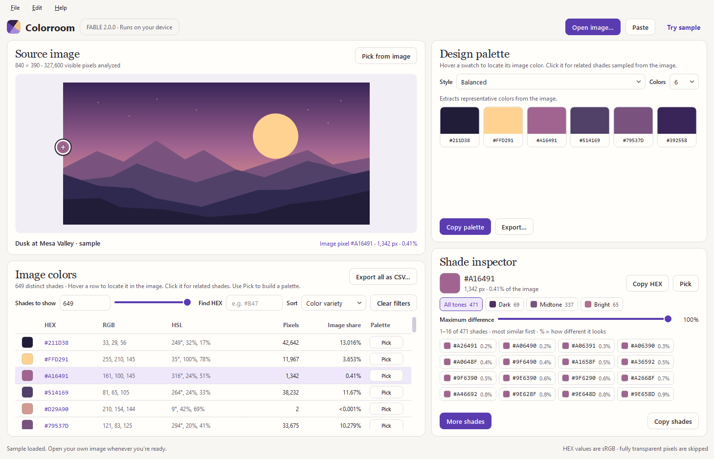

# Colorroom FABLE

Find the colors in any image. Colorroom FABLE lists every distinct HEX shade in a picture,
shows where each one appears, finds its related shades, and builds design palettes from them.

It is a standalone desktop app written in Python, rebuilt from the Colorroom web page.
Everything runs on your computer: images are never uploaded, and the app never connects to
the internet.



**Status:** 2.0 alpha, for Windows. macOS support is planned. The original browser version,
Colorroom 1.7, is still here: download [`legacy/index.html`](legacy/index.html) and open it in
a browser.

## Install

You need Windows and [Python](https://www.python.org/downloads/) 3.11 or newer.

```powershell
git clone https://github.com/Matthew-Hoke/colorroom.git
cd colorroom
python -m venv .venv
.venv\Scripts\python -m pip install -e ".[dev]"
```

## Start the app

| How | What to do |
|---|---|
| Easiest | Double-click **`Run Colorroom FABLE.bat`** in the project folder. |
| From a terminal | `.venv\Scripts\python -m colorroom` (add an image path to open it directly). |
| From VS Code | Open the folder, then **Terminal > Run Task… > Run Colorroom FABLE**, or press **F5**. |
| Standalone app | Build it once (see below), then double-click `dist\Colorroom FABLE\Colorroom FABLE.exe`. |

## What you can do

- **Open an image**: the Open button, drag and drop, paste from the clipboard (Ctrl+V), or "Try sample".
  PNG, JPG, WebP, GIF, BMP, AVIF and TIFF, up to 24 megapixels.
- **Design palette**: 13 styles. Balanced and Dominant come straight from the image. Six are
  color-wheel harmonies. The rest are Neutral, Pastel, Vibrant, Seasonal presets and a Custom
  brand palette with 60/30/10 roles. Hover a swatch to see where that color is in the image.
- **Pick colors**: turn on "Pick from image" for an eyedropper with a magnifier, or use the Pick
  buttons in the table. Your first pick is the base color for the color-wheel styles.
- **Shade inspector**: click any color to list its related shades from the image. Filter by tone
  (Deep to Light) and by maximum difference.
- **Image colors table**: every distinct color with HEX, RGB, HSL, pixel count and share. Sort by
  variety, frequency or HEX, filter by a HEX prefix, and use the slider to show fewer, more distinct shades.
- **Export**: copy the palette, or save it as CSS variables, JSON, Adobe Swatch Exchange (`.ase` for
  Photoshop, Illustrator and InDesign), a GIMP palette, a PNG swatch sheet or plain text. The full
  color list exports as CSV.

## Where the code is

```
colorroom/
  src/colorroom/
    __main__.py          starts the app
    cli.py               command-line tool (no window)
    core/                the engine: no window code in here
      loader.py          opens image files, converts color profiles to sRGB
      index.py           counts every color and builds the sort orders
      colorspace.py      HEX, Oklab, HSL and color-wheel math
      palettes.py        the 13 palette styles
      shades.py          related shades and tones
      exporters.py       CSV, CSS, JSON, ASE, GPL, PNG
      sample.py          the built-in sample image
    ui/                  the window (PySide6 / Qt)
      main_window.py     puts the panels together and handles actions
      image_view.py      the picture, markers and eyedropper magnifier
      palette_panel.py   the Design palette panel
      inspector.py       the Shade inspector panel
      inventory.py       the Image colors table
      widgets.py         chips, swatches and other small parts
      theme.py           colors, fonts and styling
      tasks.py           background work so the window never freezes
  tests/                 automated checks (see below)
  tools/                 helper scripts (fixtures, screenshots, building the .exe)
  legacy/index.html      the original Colorroom 1.7 web app
  docs/screenshots/      pictures of the app, made by tools/screenshots.py
```

## Check that everything works

```powershell
.venv\Scripts\python -m pytest -q
```

The tests compare the Python engine with what the original JavaScript produced for eight test
images (`tests/fixtures`), check the new features, and drive the real window without showing it.

## Command line

```powershell
.venv\Scripts\python -m colorroom analyze photo.jpg
.venv\Scripts\python -m colorroom analyze photo.jpg --palette triadic --pick "#B47A3C"
.venv\Scripts\python -m colorroom analyze photo.jpg -n 8 --export palette.ase --csv all-colors.csv
.venv\Scripts\python -m colorroom analyze sample --json
```

## Build the standalone app

```powershell
.venv\Scripts\python tools\build_app.py
```

This creates the folder `dist\Colorroom FABLE`. Copy or zip the whole folder to share the app;
the `.exe` needs the files beside it. The computer running it does not need Python.

## Privacy and security

Colorroom FABLE has no network code. Images are opened, analyzed and exported on your own
computer. The only things it remembers are your window layout and recent-files list, which
stay in your user profile.

To report a security problem, see [SECURITY.md](SECURITY.md).

## What changed from Colorroom 1.7

- Runs as a desktop app, with menus, drag and drop, paste and recent files.
- The Shade range feature that existed in the page but was never connected now works
  (the Maximum difference slider), and tones can be filtered.
- Related shades are instant: colors are converted to Oklab once instead of on every click.
- Palette colors are matched against every image color, however many there are.
- Embedded color profiles (Display P3, Adobe RGB, CMYK) are converted to sRGB, and camera
  rotation is applied.
- Monochromatic and Seasonal palettes follow the Colors setting.
- The color table scrolls through every color without paging, and adds RGB and HSL columns.
- New exports: Adobe `.ase`, GIMP `.gpl`, JSON, PNG swatch sheet.
- An eyedropper magnifier for picking exact pixels.
